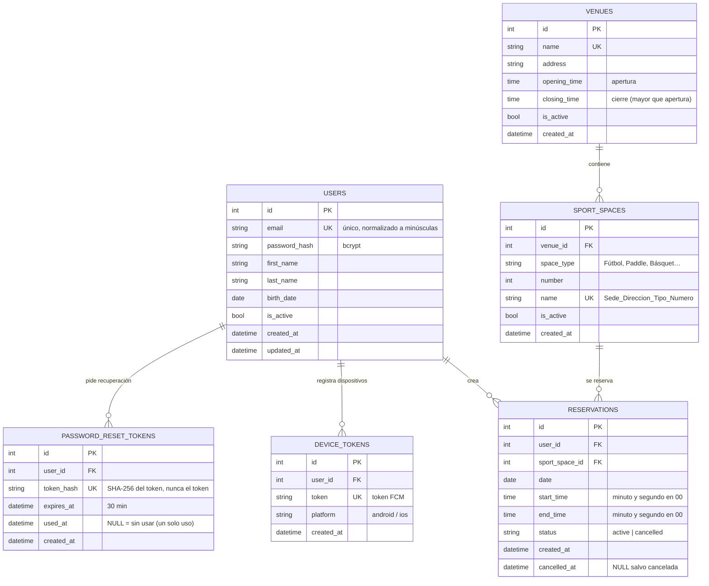

# Modelo de datos — ClubSebastianMartinezAmaray

Base de datos relacional **PostgreSQL**, modelada con SQLAlchemy 2.0 (`app/models.py`).
El esquema se crea con `Base.metadata.create_all` al arrancar la API.

## Diagrama entidad-relación



## Entidades y decisiones

### `users`
Usuario de la app. El `email` es único y se guarda normalizado (minúsculas, sin espacios), así
`Juan@Club.com` y `juan@club.com` no pueden coexistir. La contraseña **nunca** se guarda en claro:
se persiste el hash bcrypt. El correo no se puede editar (regla 10).

### `password_reset_tokens`
Token de recuperación de contraseña, de un solo uso, con vencimiento.
Por seguridad se guarda únicamente el **hash SHA-256** del token; el valor en claro sólo existe en
el mail (o en el log / la respuesta si no hay SMTP y `DEBUG=true`). `used_at` marca el consumo: una
vez usado, el token queda invalidado (segundo intento → 400 `reset_token_used`).

### `device_tokens`
Tokens de dispositivo (FCM) para el módulo de notificaciones push. Un token es único: si el mismo
dispositivo vuelve a registrarse, se reasigna al usuario que lo registra.

### `venues`
Sede deportiva: nombre, dirección y horario de funcionamiento modelado como hora de apertura y de
cierre (`time`). Hay un `CHECK (opening_time < closing_time)`. Las reservas tienen que caer dentro de
esa ventana (regla 4).

### `sport_spaces`
Espacio deportivo perteneciente a una sede. El `name` se compone con sede, dirección, tipo de espacio
y número, según pide la consigna:

```
Moron_Rivadavia_19850_Paddle_1
```

Hay una `UNIQUE (venue_id, space_type, number)`, así que no puede haber dos "Paddle 1" en la misma
sede. El `space_type` está indexado porque el listado se filtra por tipo.

### `reservations`
Reserva de un espacio para una fecha y un rango horario. `status` es `active` o `cancelled`;
**no se borra nunca** (regla 8). Las reglas de negocio que se validan antes de insertar:

| Regla | Validación |
|---|---|
| 1 | `end_time - start_time >= 1h` |
| 2 | minuto y segundo en `00` en ambos extremos |
| 3 | `start_time < end_time` |
| 4 | `opening_time <= start_time` y `end_time <= closing_time` de la sede |
| 5 | `datetime(date, start_time) > now()` |
| 6 | sin solapamiento: `start < otro_end and end > otro_start` contra reservas **activas** |
| 7 | validación + insert **atómicos** (`SELECT … FOR UPDATE` sobre la fila del espacio) |
| 8 | cancelar pasa a `cancelled` y libera el horario |

### Integridad y concurrencia

- `SELECT … FOR UPDATE` sobre `sport_spaces` al crear una reserva: dos pedidos simultáneos del mismo
  espacio se serializan. El segundo ve la reserva ya commiteada y responde **409**.
- Índices: `reservations(user_id)`, `reservations(sport_space_id)`, `reservations(date)`,
  `reservations(status)` — pensados para la consulta de solapamiento y para las listas por usuario.
- `ON DELETE CASCADE` de usuarios y espacios hacia sus reservas y tokens.

### Historial

El historial no es una tabla aparte: se deriva del estado y del tiempo (regla 9).

- **Vigentes** (`GET /reservations`): `status = active` y el fin todavía no pasó.
- **Historial** (`GET /reservations/history`): las terminadas (`date, end_time` anteriores a ahora)
  más las canceladas, distinguidas por `status`.
